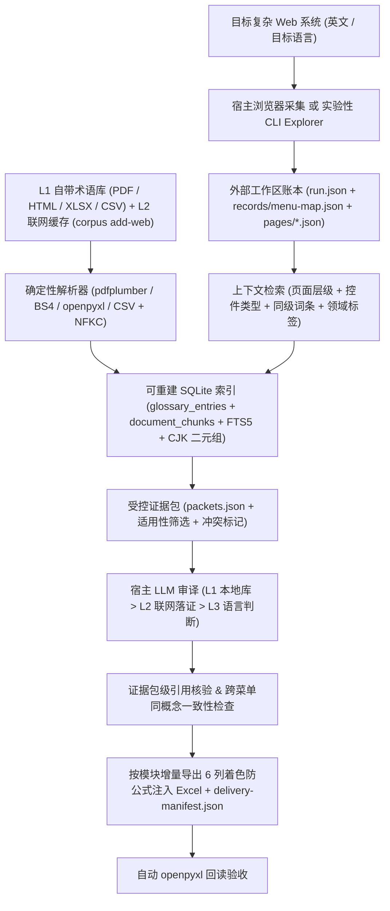

<div align="center">

# lingual-audit

### 面向复杂 Web 系统的双语界面审译 Agent Skill 与本地混合检索工具链

[](LICENSE)
[](SKILL.md)
[](#与不同-ai-工具配合)
[](pyproject.toml)
[](LICENSE)

<br>

几百个页面里攒了几千条错译、漏译和裸露 i18n Key，靠人一页页翻要花好几周？<br>
把行业规范 PDF 直接丢给大模型审译，却总碰到短词漏召回、编造出处、前后菜单译法打架？<br>
想让 Agent 帮着点页面查校验提示，又怕误触表单自动保存往后端写脏数据？<br>

<br>

**行业无关 · 自带术语库（BYOG） · 三层证据校验 · 按模块增量交付 · 6 列着色 Excel**

[English](README_EN.md) · [对比](#为什么不用裸大模型直接审) · [主要功能](#主要功能) · [工作流](#工作流总览) · [Excel 规范](#6-列-excel-交付规范) · [快速上手](#快速上手) · [贡献指南](CONTRIBUTING.md)

</div>

`lingual-audit` 把界面审译里的两件事拆开了：语义判断交给大模型，词条建库、本地混合检索、证据包级引用核验和 Excel 回读验收全部交给确定性 Python 工具来做。你可以接入任意行业的本地术语库，配合联网查证落盘和大模型语言判断，按功能模块边审边导出可交付的 6 列着色 Excel 审查表。

## 为什么不用裸大模型直接审

| 直接把参考 PDF 丢给大模型 | `lingual-audit` |
|---|---|
| 2–3 字母缩写和短中文词经常漏召回 | 精确词表通道 + SQLite FTS5 + CJK 二元组离线检索 |
| 模型偶尔编造页码、条款号或乱引无关条目 | `review validate` 绑定 `packets.json` 证据包逐条核验哈希 |
| 英文单语定义被拿来硬套中文译名 | 适用性优先过滤，机械拦截英文单语证据授权中文改译 |
| 扫完几百页才出表，中途断了容易前功尽弃 | 每完成一个功能模块即落盘并增量导出到 Excel |
| 审译与验收混在一起，表里公式和原词难核对 | 6 列着色纯文本防公式注入，导出后自动 `openpyxl` 回读校验 |

## 主要功能

- **自带术语库（BYOG）+ 联网证据落盘**：初始化工作区时会生成空白术语库槽位（`corpus/raw/`、`corpus/manifest.json`、`corpus/authority_policy.json`）。无论金融、医疗、制造、SaaS 还是电商，把 `PDF`、`HTML`、`XLSX`、`CSV` 术语表和规范放进去就能直接跑。本地库没命中时，宿主 Agent 可以联网查证，再用 `lingual-audit corpus add-web` 把网页 URL 和原文摘录落盘进 `corpus/web_cache/`，直接进入同一套本地索引和哈希核验流程；同时支持在 `authority_policy.json` 里按域名配置权威等级。
- **三层证据校验（L1 > L2 > L3）**：审译严格按优先级结合三类依据——**L1 本地自带术语库**（最高权威）> **L2 联网查证缓存**（通过 `corpus add-web` 落证入库）> **L3 大模型语言判断**（无外部标准时用于识别明显错译、语病与裸露 Key，并在理由栏注明 `[LLM 语义判断]`）。
- **按模块增量落盘交付**：每完成一个功能模块的采集和审译，立即落盘到 `records/pages/<page_id>.json` 并合并进 `records/review.json`，随即导出或更新 Excel 工作簿，后续每做完一个模块就往里补一个 Sheet，不用等全站扫完才看到结果。
- **单文件 SQLite FTS5 与证据包级引用校验**：内置 `pdfplumber`、`BeautifulSoup`、`openpyxl` 和 `csv` 解析器，保留原文与 NFKC 归一化双视图（顺带修复 PDF 中常见的康熙部首偏旁如 `⼿`、`⽅`）。`review validate` 自动对照 `packets.json` 核对每条引用必须属于当前词条自身的证据包，拦截无证据改译和跨词条错配引用。
- **实验性自动采集器与网络隔离**：`lingual-audit explore` 目前为实验性功能（需要 `playwright>=1.48`），支持 `quick`、`standard`、`thorough` 三档。它依赖 `[data-menu]`、`[data-i18n]`、`placeholder` 等标准语义标记，抓到 0 条词条时如实标为 `blocked` 而不会误报 `fully_inspected`。面对自定义 DOM 的真实系统，推荐直接用宿主浏览器工具或已录入的 UI JSON 走主流程。
- **6 列着色防公式注入 Excel 与自动回读**：按功能菜单分 Sheet 输出，6 种结论状态各自配了浅底色方便筛选，所有单元格强制写为纯文本（`=SpotRate + Margin` 等不会变成公式），导出后自动执行 `openpyxl` 回读与行级 SHA-256 校验。

## 工作流总览



## 6 列 Excel 交付规范

| 列 | 表头 | 内容要求 |
|---|---|---|
| A | `页面层级` | 完整界面层级路径（`菜单 > 页面状态 > 区域 > 控件`） |
| B | `系统英文` | 页面观测到的英文原文（纯文本单元，防公式注入） |
| C | `系统中文` | 页面观测到的目标语言原文（缺失时留空） |
| D | `AI 建议中文` | 建议改译词（`保留` 或未核对到双语时留空） |
| E | `比对结论` | 6 类着色结论状态，见下表 |
| F | `修改理由与业务依据` | 只要结论不是 `保留` 就必须填写，从业务含义、风险和出处标签出发（如 `[CN-FX-2025 §1.1]`、`[Web:w3.org]`、`[LLM 语义判断]`） |

**结论状态口径**：`待核对` 只放确实没核对到双语的情况（未配对、单侧未观测、页面受限未展开）；只要中英文都已经核对到，不允许留中间态，除 `缺译`、`单语限制`、`来源冲突` 外，直接在 `保留` 和 `建议修改` 中二选一。

| `比对结论` | 单元格底色 | 适用场景 |
|---|---|---|
| `保留` | 浅绿 `#E8F5E9` | 已核对双语，当前译文准确且上下文一致 |
| `建议修改` | 浅黄 `#FFF8E1` | 已核对双语，存在错译、不规范或同领域跨菜单漂移 |
| `缺译` | 浅红 `#FFEBEE` | 目标语言为空或暴露原始 i18n Key |
| `来源冲突` | 浅橙 `#FFF3E0` | 同一适用范围内存在多个权威来源译法冲突，列出双方依据交业务拍板 |
| `单语限制` | 浅灰 `#ECEFF1` | 已确认的单语内嵌 iframe 或第三方组件 |
| `待核对` | 浅紫 `#F3E5F5` | 确实没核对到双语（控件未配对、单侧观测或页面受限阻塞） |

## 快速上手

```bash
# 1. 创建虚拟环境并安装（支持源码 editable 安装，也支持构建 wheel 在仓库外直接运行）
python3 -m venv --system-site-packages .venv
.venv/bin/pip install -e ".[dev,browser]"

# 2. 探测本机运行能力
.venv/bin/lingual-audit doctor --json

# 3. 初始化外部工作区（自动生成空白 BYOG 术语库槽位与默认策略）
.venv/bin/lingual-audit run init \
  --workspace /tmp/my-audit-ws \
  --run-id RUN-20261127-0001 \
  --app-label "示例复杂 Web 系统" \
  --industry "general_web" \
  --depth standard

# 4. 将本领域的 PDF/HTML/XLSX/CSV 放入 /tmp/my-audit-ws/corpus/raw/ 并在 manifest.json 登记
#    本地库缺失时，也可以随时用 corpus add-web 录入联网查证的网页摘录：
.venv/bin/lingual-audit corpus add-web \
  --manifest /tmp/my-audit-ws/corpus/manifest.json \
  --url "https://developer.mozilla.org/en-US/docs/Web/HTTP/Headers/Idempotency-Key" \
  --title "Idempotency-Key" \
  --en-term "Idempotency Key" \
  --zh-term "幂等键" \
  --excerpt "Idempotency Key ensures repeated requests have the same effect as a single request." \
  --policy /tmp/my-audit-ws/corpus/authority_policy.json

# 5. 解析语料并重建 SQLite FTS5 索引
.venv/bin/lingual-audit corpus ingest --manifest /tmp/my-audit-ws/corpus/manifest.json --output-dir /tmp/my-audit-ws/corpus/normalized
.venv/bin/lingual-audit corpus index --normalized-dir /tmp/my-audit-ws/corpus/normalized --db-path /tmp/my-audit-ws/corpus/index.sqlite

# 6. 运行确定性测试集
.venv/bin/pytest -v -p no:anyio
```

## 与不同 AI 工具配合

仓库内置自包含的 [SKILL.md](SKILL.md)、[references/](references) 和 [templates/](templates)，未打包任何第三方 Skill：

- **Claude Code / Codex / Antigravity / WorkBuddy**：直接加载本仓库根目录或将 `SKILL.md`、`references/`、`templates/` 放入宿主 Skills 目录即可自动识别触发。
- **任意其他大模型 / Agent**：方法论和 CLI 本身都是模型无关的（LLM-agnostic）。你可以让任意模型读取 [SKILL.md](SKILL.md) 和 [references/](references) 里的协议，配合本机 `lingual-audit` CLI 完成检索引证、校验和导出。

## 几个关键取舍

**先筛适用范围，再比来源优先级。**
多地区系统里，港台译名（`zh-HK`）和内地标准（`zh-CN`）很多时候只是地区习惯不同，不算错译；英文单语的国际标准能解释概念，但不能拿来给中文界面译名背书。先按领域、地区、语言变体和双语性质筛一遍，再在同一适用范围内按 `authority_policy.json` 裁决，遇到真实冲突直接标成 `来源冲突` 交给业务方拍板。

**先用精确词表 + SQLite FTS5 + CJK 二元组，向量检索做成可选消融项。**
Web 界面里的词条大多很短，比如两三个字母的缩写或者两个字的中文术语。纯向量检索在短词上容易跑偏，SQLite 自带的 `trigram` 分词器也匹配不了少于 3 个字符的词。单文件 SQLite 加上精确通道和二元组索引，不依赖外部服务和 API Key，本地离线就能稳定复现结果。仓库里同时预留了 RRF 向量融合接口，需要的话可以在黄金集上跑三组消融对比（裸读 vs 词表+FTS vs 混合向量），看数据再决定是否开启。

**`thorough` 模式输入测试数据时，必须上独立 Context 断网。**
只靠“不点提交按钮”并不安全，现在很多 Web 表单在 `input`、`change`、`blur` 甚至防抖定时器里就会发 `POST` 自动保存。在独立隔离的 Context 里禁掉 Service Worker、全程拦住 HTTP/WebSocket 请求（依赖 `playwright>=1.48`）、测完立刻销毁 Context，才能确保不会往后端写脏数据。

**把人工看审的 Excel 和机器校验的 JSON 分开。**
业务同学看表时，希望左边一眼看清页面层级、中间靠颜色筛出待改项、右边直接看到业务角度的修改理由；工程验收则需要行级 SHA-256 哈希和可核验的出处 ID。Excel 保持 6 列干净好读，完整的结构化出处和校验信息放在同目录的 `review.json` 和 `delivery-manifest.json` 里，两边互不干扰。

## Contributing

欢迎提 Issue 或 PR，尤其是多格式语料解析器增强、行业无关的黄金集评测样例、浏览器语义采集改进以及文档翻译。提交前请阅读 [CONTRIBUTING.md](CONTRIBUTING.md) 并确保 `ruff`、`pytest` 和 `lingual-audit sanitize-check` 全部通过。

## License

本项目采用 [MIT License](LICENSE) 开源，允许自由使用、修改与分发。

页面探索和文件化续跑的思路参考了 `app-docs` 与 `planning-with-files`，本仓库未打包任何第三方 Skill，所有规范、模板和工具链均按 MIT 协议独立实现。
