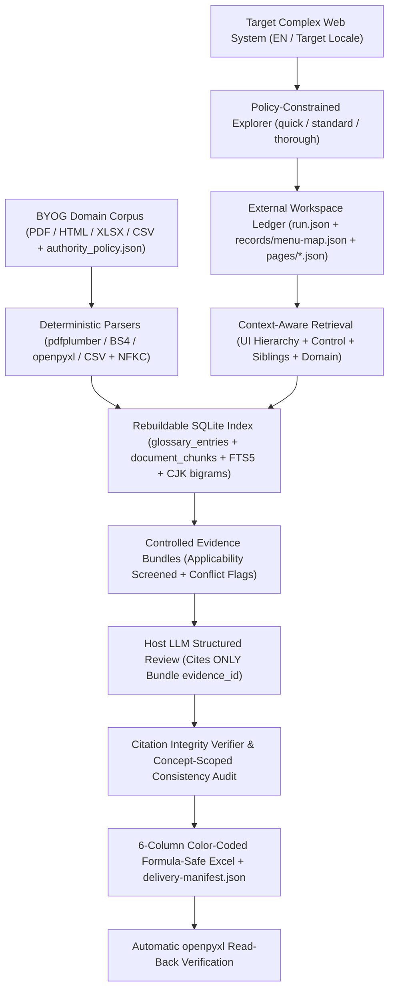

# lingual-audit

[中文说明 (README_CN.md)](README_CN.md)

A **domain-agnostic**, self-contained **Agent Skill + deterministic Python CLI/RAG toolchain** for bilingual UI inventory, terminology standardization, and auditable Excel delivery on **complex web systems**.

> **Why this exists:** Complex web applications across any domain (FinTech, Healthcare, Manufacturing, SaaS, E-commerce, Developer Tools, etc.) often accumulate thousands of inconsistent, mistranslated, or raw-key UI strings across hundreds of views. Manual bilingual audits take weeks of effort, while naive "let an LLM read reference PDFs" workflows suffer from missed recalls, fabricated citations, cross-menu drift, and unsafe form mutations. `lingual-audit` separates **probabilistic LLM judgment** from **deterministic UI collection, hybrid retrieval, citation verification, and Excel read-back**.

---

## Key Capabilities

- **Bring-Your-Own-Glossary (BYOG) — Any Domain, Zero Hardcoding**: Ships with an empty default knowledge base slot (`corpus/raw/`, `corpus/manifest.json`, `corpus/authority_policy.json`). Drop any domain's `PDF`, `HTML`, `XLSX`, or `CSV` glossaries and standards in—no code changes required. Even an empty corpus degrades gracefully (`no_authoritative_hit=True`).
- **Zero-Vendor Self-Contained Agent Skill**: Native [SKILL.md](SKILL.md) + [references/](references) + [templates/](templates) work across Claude Code, Codex, Antigravity, and WorkBuddy without vendoring third-party skills.
- **Policy-Constrained Exploration with `thorough` Network Isolation**: Supports `quick` / `standard` / `thorough` depths. In `thorough` mode, synthetic test-data probing to surface client-side validation messages runs inside a dedicated isolated Playwright context (`service_workers="block"`, HTTP + WebSocket outbound permanently blocked until the probe context is destroyed—blocking even delayed debounced auto-save timers).
- **Single-File SQLite FTS5 + Applicability-First Arbitration**: Parses multi-format corpora into dual verbatim/NFKC-normalized views with CJK bigram indexing and exact short-acronym channels (`FX`, `IRS`, `BIC`), screening sources by **domain/region/locale applicability first** before applying normative precedence.
- **6-Column Color-Coded, Formula-Safe Excel Delivery**: Generates per-menu worksheets (`页面层级 | 系统英文 | 系统中文 | AI 建议中文 | 比对结论 | 修改理由与业务依据`) with distinct verdict fill colors, mandatory business-first rationales for non-`保留` items, formula-injection protection, and automatic `openpyxl` read-back verification.

---

## Architecture Overview



---

## Product Design Decisions & Trade-offs

1. **Why Applicability Screening First instead of a Global Agency Ranking?**
   In multi-region web products, regional terminology (e.g., `zh-HK` vs `zh-CN`) is often a legitimate regional variant rather than an error, and an English-only international standard explains concept meaning without authorizing a target-language UI label. Screening by `(domain, region, target_locale, language_scope)` before comparing `normative_precedence` prevents false overrides and keeps real conflicts transparent.
2. **Why Exact Glossary + SQLite FTS5 + CJK Bigrams BEFORE Dense Vectors?**
   Web UI labels are short (often 2–3 character acronyms or 2-character Chinese terms where naive embeddings drift and SQLite's built-in `trigram` tokenizer cannot match <3 characters). A single-file SQLite + FTS5 + NFKC/CJK-bigram engine runs with **zero external daemons, zero API keys, and deterministic tests**, while leaving an extensible RRF vector hook evaluated strictly via 3-arm Golden Set ablations.
3. **Why Dedicated Isolated Playwright Contexts for `thorough` Synthetic Input Probing?**
   "Not clicking Submit" is not a safety proof—modern web forms frequently trigger `POST`/`PUT` auto-save requests on `input`, `change`, `blur`, or debounced timers. Keeping HTTP and WebSocket blocking active for the entire probe context and destroying that context immediately afterwards guarantees zero backend writes; hosts without network isolation automatically skip synthetic probes.
4. **Why 6-Column Color-Coded Excel + Sibling JSON Manifests?**
   Reviewers want immediate visual triage (UI hierarchy path on the left, color-coded verdict pill, and business-first rationale on the right), while engineering verification needs immutable SHA-256 provenance and row hashes. Keeping Excel clean and formula-safe while storing full structured citations in `review.json` / `delivery-manifest.json` satisfies both audiences.

---

## 6-Column Excel Output Specification

| Column | Header | Purpose |
|---|---|---|
| A | `页面层级` | Full UI hierarchy (`Menu > Page State > Section > Control`) |
| B | `系统英文` | Verbatim observed English UI text (explicit text cell, formula-safe) |
| C | `系统中文` | Verbatim observed target-language UI text |
| D | `AI 建议中文` | Suggested translation (blank when `保留` or uncertain) |
| E | `比对结论` | Color-coded verdict (`保留`, `建议修改`, `缺译`, `来源冲突`, `单语限制`, `待业务确认`, `待核对`) |
| F | `修改理由与业务依据` | Business-first rationale with brief provenance tag (required whenever verdict ≠ `保留`) |

---

## Quick Start

```bash
# 1. Create virtualenv & install
python3 -m venv --system-site-packages .venv
.venv/bin/pip install -e ".[dev,browser]"

# 2. Check runtime capabilities
.venv/bin/lingual-audit doctor --json

# 3. Initialize an external BYOG workspace for any domain
.venv/bin/lingual-audit run init \
  --workspace /tmp/my-audit-ws \
  --run-id RUN-20261127-0001 \
  --app-label "My Web System" \
  --industry "general_web" \
  --depth standard

# 4. Drop your PDF/HTML/XLSX/CSV glossaries into /tmp/my-audit-ws/corpus/raw/
#    and declare them in /tmp/my-audit-ws/corpus/manifest.json, then:
.venv/bin/lingual-audit corpus ingest --manifest /tmp/my-audit-ws/corpus/manifest.json --output-dir /tmp/my-audit-ws/corpus/normalized
.venv/bin/lingual-audit corpus index --normalized-dir /tmp/my-audit-ws/corpus/normalized --db-path /tmp/my-audit-ws/corpus/index.sqlite

# 5. Run deterministic test suite
.venv/bin/pytest -v -p no:anyio
```

---

## Acknowledgments

Inspired by route-discovery conventions from `app-docs` and disk-backed session checkpointing from `planning-with-files`. Neither skill is vendored into this repository; all exploration, checkpointing, retrieval, and delivery protocols are implemented natively under MIT license.
