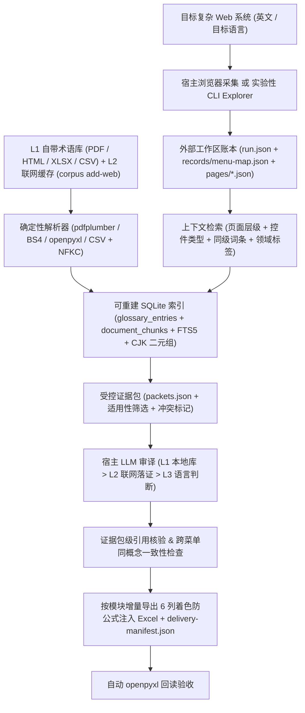

<div align="center">

# lingual-audit

面向复杂 Web 系统的双语界面审译 Agent Skill 与本地混合检索工具

[](LICENSE)
[](SKILL.md)
[](#与不同-ai-工具配合)
[](pyproject.toml)
[](LICENSE)

<br>

[English](README_EN.md) · [区别对比](#和直接让大模型审译的区别) · [主要功能](#主要功能) · [工作流](#工作流总览) · [Excel 规范](#6-列-excel-交付规范) · [快速上手](#快速上手) · [参与贡献](CONTRIBUTING.md)

</div>

`lingual-audit` 是一个面向复杂 Web 系统的双语界面审译工具，包含一套自包含的 Agent Skill 和对应的 Python 命令行工具。它可以把运行中系统的中英文界面词条盘点出来，结合本地自带术语库、联网查证缓存和大模型语言判断完成审译与引用核验，最后按模块增量导出带颜色标注、防公式注入的 6 列 Excel 审查表。

金融、医疗、制造、SaaS、电商、开发者平台这类复杂 Web 系统，跑久了通常会在几百个页面里攒下几千条错译、漏译、裸露 i18n Key 或跨菜单译名不统一的问题。靠人一页页翻查往往要花好几周；直接把几本参考 PDF 丢给大模型看，又容易漏掉短词、编造出处、前后菜单译法打架，甚至在点页面时误触表单自动保存。`lingual-audit` 把这两件事拆开了：语言判断交给大模型，本地检索、引用核验和 Excel 回读全部交给确定性脚本来做。

## 和直接让大模型审译的区别

| 直接把参考 PDF 丢给大模型 | `lingual-audit` |
|---|---|
| 两三个字母的缩写和短中文词经常漏掉 | 精确词表通道 + SQLite FTS5 + CJK 二元组离线检索 |
| 容易编造页码、条款号，或者引到无关条目 | `review validate` 对照 `packets.json` 证据包逐条核对哈希 |
| 英文单语定义容易被拿来硬套中文译名 | 先按领域、地区和双语性质过滤，不让英文单语定义背书中文改译 |
| 几百个页面全扫完才出表，中途断了不好接续 | 每做完一个功能模块就落盘并增量更新到 Excel |
| 表格里的公式文本和原词不好核对 | 6 列纯文本单元格防公式注入，导出后自动用 `openpyxl` 回读校验 |

## 主要功能

- **自带术语库（BYOG）与联网证据落盘**：初始化工作区时会生成空白术语库目录（`corpus/raw/`、`corpus/manifest.json`、`corpus/authority_policy.json`）。无论什么行业，把 `PDF`、`HTML`、`XLSX` 或 `CSV` 格式的术语表和规范放进去就能直接跑，不需要改代码。本地库没命中时，可以让宿主 Agent 联网查证，再用 `lingual-audit corpus add-web` 把网页 URL 和原文摘录存到 `corpus/web_cache/`，直接进入同一套本地索引和哈希核验；`authority_policy.json` 里也可以按域名配置权威等级。
- **三层证据校验**：审译按优先级结合三类依据：先查本地自带术语库（L1），未命中或需要消歧时走联网查证并落盘入库（L2），两者都没有外部标准时再由大模型结合上下文做语言判断（L3，并在理由栏写明 `[LLM 语义判断]`）。
- **按模块增量交付**：每完成一个功能模块的采集和审译，直接把该模块写入 `records/pages/<page_id>.json` 并合并进 `records/review.json`，随即导出或更新 Excel 工作簿，后续每做完一个模块就往里补一个 Sheet，不用等全站扫完才看到成果。
- **单文件 SQLite FTS5 与证据包级引用核验**：内置 `pdfplumber`、`BeautifulSoup`、`openpyxl` 和 `csv` 解析器，同时保存原文和 NFKC 归一化文本（顺带修掉 PDF 里常见的康熙部首偏旁，比如 `⼿`、`⽅`）。`review validate` 会对照 `packets.json` 检查每条引用是否真的来自当前词条的证据包，拦住无证据改译和跨词条错配引用。
- **实验性自动采集器与网络隔离**：`lingual-audit explore` 目前为实验性功能（需要 `playwright>=1.48`），支持 `quick`、`standard`、`thorough` 三档。它依赖 `[data-menu]`、`[data-i18n]`、`placeholder` 等标准语义标记，如果页面抓到 0 条词条会如实标为 `blocked`，不会误报 `fully_inspected`。面对自定义 DOM 的真实系统，推荐用宿主浏览器工具或已录入的 UI JSON 走主流程。
- **6 列着色 Excel 与自动回读**：按功能菜单分 Sheet 输出，6 种结论状态各自配了浅底色方便筛选。所有单元格强制写为纯文本，像 `=SpotRate + Margin` 这类内容不会变成 Excel 公式，导出后会自动用 `openpyxl` 回读核对内容和 SHA-256 哈希。

## 工作流总览



## 6 列 Excel 交付规范

| 列 | 表头 | 内容要求 |
|---|---|---|
| A | `页面层级` | 完整界面层级路径（`菜单 > 页面状态 > 区域 > 控件`） |
| B | `系统英文` | 页面观测到的英文原文（纯文本单元，防公式注入） |
| C | `系统中文` | 页面观测到的目标语言原文（缺失时留空） |
| D | `AI 建议中文` | 建议改译词（`保留` 或未核对到双语时留空） |
| E | `比对结论` | 6 类着色结论状态，见下表 |
| F | `修改理由与业务依据` | 只要结论不是 `保留` 就必须填写，写清业务含义、风险和出处标签（如 `[CN-FX-2025 §1.1]`、`[Web:w3.org]`、`[LLM 语义判断]`） |

`待核对` 只放确实没核对到双语的情况（未配对、单侧未观测、页面受限未展开）。只要中英文都已经核对到，就不留中间态，除 `缺译`、`单语限制`、`来源冲突` 外，直接在 `保留` 和 `建议修改` 里二选一。

| `比对结论` | 单元格底色 | 适用场景 |
|---|---|---|
| `保留` | 浅绿 `#E8F5E9` | 已核对双语，当前译文准确且上下文一致 |
| `建议修改` | 浅黄 `#FFF8E1` | 已核对双语，存在错译、不规范或同领域跨菜单漂移 |
| `缺译` | 浅红 `#FFEBEE` | 目标语言为空或暴露原始 i18n Key |
| `来源冲突` | 浅橙 `#FFF3E0` | 同一适用范围内存在多个权威来源译法冲突，列出双方依据交业务拍板 |
| `单语限制` | 浅灰 `#ECEFF1` | 已确认的单语内嵌 iframe 或第三方组件 |
| `待核对` | 浅紫 `#F3E5F5` | 确实没核对到双语（控件未配对、单侧观测或页面受限阻塞） |

## 快速上手

### 1. 安装并检查环境

```bash
# 支持源码 editable 安装，也支持构建 wheel 后在仓库外直接运行
python3 -m venv --system-site-packages .venv
.venv/bin/pip install -e ".[dev,browser]"
.venv/bin/lingual-audit doctor --json
```

### 2. 用内置合成样例跑通完整流程（直出 Excel）

仓库自带脱敏合成样例（`tests/fixtures/`），不依赖外部网络或真实系统，直接复制下面命令就能从建库一路跑出 6 列着色 Excel 并完成回读验收：

```bash
mkdir -p /tmp/lingual-audit-demo

# 解析合成语料并建立 SQLite FTS5 索引
.venv/bin/lingual-audit corpus ingest --manifest tests/fixtures/corpus/manifest.json --output-dir /tmp/lingual-audit-demo/normalized
.venv/bin/lingual-audit corpus index --normalized-dir /tmp/lingual-audit-demo/normalized --db-path /tmp/lingual-audit-demo/index.sqlite

# 为合成界面词条生成受控证据包
.venv/bin/lingual-audit review prepare --db-path /tmp/lingual-audit-demo/index.sqlite --records-dir tests/fixtures/records --output /tmp/lingual-audit-demo/packets.json --policy tests/fixtures/corpus/authority_policy.json

# 用离线示例脚本模拟宿主 LLM 输出审译结果
.venv/bin/python3 examples/build_demo_review.py /tmp/lingual-audit-demo/packets.json /tmp/lingual-audit-demo/review.json

# 证据包级引用核验 + 跨菜单一致性检查
.venv/bin/lingual-audit review validate --review-file /tmp/lingual-audit-demo/review.json --db-path /tmp/lingual-audit-demo/index.sqlite --records-dir tests/fixtures/records --packets /tmp/lingual-audit-demo/packets.json
.venv/bin/lingual-audit review consistency --review-file /tmp/lingual-audit-demo/review.json

# 导出 6 列着色 Excel（附 _Summary / _Consistency）并执行自动回读验收
.venv/bin/lingual-audit export --menu-map tests/fixtures/records/menu-map.json --review-file /tmp/lingual-audit-demo/review.json --output-xlsx /tmp/lingual-audit-demo/audit.xlsx --manifest-output /tmp/lingual-audit-demo/delivery-manifest.json --with-summary
.venv/bin/lingual-audit verify --workbook /tmp/lingual-audit-demo/audit.xlsx --manifest /tmp/lingual-audit-demo/delivery-manifest.json --review-file /tmp/lingual-audit-demo/review.json
```

跑完后打开 `/tmp/lingual-audit-demo/audit.xlsx` 就能看到按菜单分 Sheet 的 6 列着色审查表，且 `verify` 会返回 `"verified": true`。

### 3. 初始化你自己的工作区（可选）

```bash
# 初始化外部工作区（自动生成空白 BYOG 术语库目录与默认策略）
.venv/bin/lingual-audit run init \
  --workspace /tmp/my-audit-ws \
  --run-id RUN-20261127-0001 \
  --app-label "示例复杂 Web 系统" \
  --industry "general_web" \
  --depth standard

# 本地库缺失时，随时用 corpus add-web 录入联网查证的网页摘录
.venv/bin/lingual-audit corpus add-web \
  --manifest /tmp/my-audit-ws/corpus/manifest.json \
  --url "https://developer.mozilla.org/en-US/docs/Web/HTTP/Headers/Idempotency-Key" \
  --title "Idempotency-Key" \
  --en-term "Idempotency Key" \
  --zh-term "幂等键" \
  --excerpt "Idempotency Key ensures repeated requests have the same effect as a single request." \
  --policy /tmp/my-audit-ws/corpus/authority_policy.json

# 运行确定性测试集
.venv/bin/pytest -v -p no:anyio
```

## 与不同 AI 工具配合

仓库内置了 [SKILL.md](SKILL.md)、[references/](references) 和 [templates/](templates)，没有打包第三方 Skill：

- **Claude Code / Codex / Antigravity / WorkBuddy**：直接加载本仓库根目录，或把 `SKILL.md`、`references/`、`templates/` 放到宿主 Skills 目录即可使用。
- **其他大模型或 Agent**：审译流程和命令行工具本身不绑定特定模型。只要让模型读取 [SKILL.md](SKILL.md) 和 [references/](references) 里的规则，再配合本机 `lingual-audit` 命令做检索、校验和导出就行。

## 几个关键取舍

**先筛适用范围，再比来源优先级。**
多地区系统里，港台译名（`zh-HK`）和内地标准（`zh-CN`）很多时候只是地区习惯不同，不算错译；英文单语的国际标准能解释概念，但不能拿来给中文界面译名背书。先按领域、地区、语言变体和双语性质筛一遍，再在同一适用范围内按 `authority_policy.json` 裁决，遇到真实冲突直接标成 `来源冲突` 交给业务方拍板。

**先用精确词表 + SQLite FTS5 + CJK 二元组，向量检索做成可选消融项。**
Web 界面里的词条大多很短，比如两三个字母的缩写或者两个字的中文术语。纯向量检索在短词上容易跑偏，SQLite 自带的 `trigram` 分词器也匹配不了少于 3 个字符的词。单文件 SQLite 加上精确通道和二元组索引，不依赖外部服务和 API Key，本地离线就能稳定复现结果。仓库里同时预留了 RRF 向量融合接口，需要的话可以在黄金集上跑三组消融对比（裸读 vs 词表+FTS vs 混合向量），看数据再决定是否开启。

**`thorough` 模式输入测试数据时，必须上独立 Context 断网。**
只靠“不点提交按钮”并不安全，现在很多 Web 表单在 `input`、`change`、`blur` 甚至防抖定时器里就会发 `POST` 自动保存。在独立隔离的 Context 里禁掉 Service Worker、全程拦住 HTTP/WebSocket 请求（依赖 `playwright>=1.48`）、测完立刻销毁 Context，才能确保不会往后端写脏数据。

**把人工看审的 Excel 和机器校验的 JSON 分开。**
业务同学看表时，希望左边一眼看清页面层级、中间靠颜色筛出待改项、右边直接看到业务角度的修改理由；工程验收则需要行级 SHA-256 哈希和可核验的出处 ID。Excel 保持 6 列干净好读，完整的结构化出处和校验信息放在同目录的 `review.json` 和 `delivery-manifest.json` 里，两边互不干扰。

## 参与贡献

欢迎提 Issue 或 PR，比如补充多格式语料解析、跨行业脱敏测试样例、浏览器采集改进或文档翻译。具体环境搭建和检查命令见 [CONTRIBUTING.md](CONTRIBUTING.md)。

## 开源协议

本项目基于 [MIT License](LICENSE) 开源。

页面探索和文件化续跑的思路参考了 `app-docs` 与 `planning-with-files`，本仓库未打包任何第三方 Skill，所有规范、模板和工具链均按 MIT 协议独立实现。
