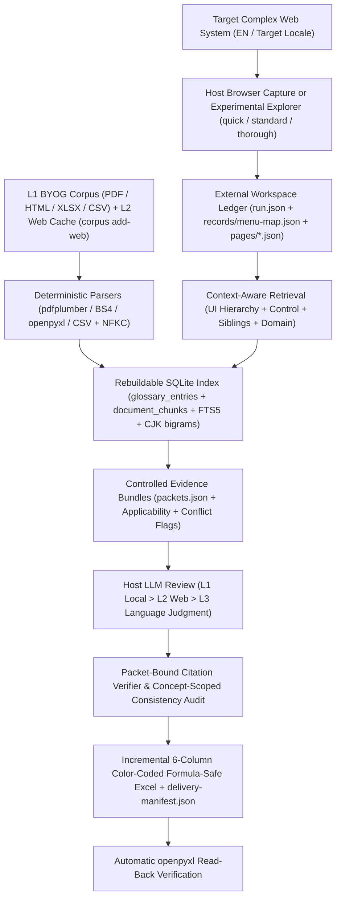

# lingual-audit

[中文说明 (README_CN.md)](README_CN.md)

`lingual-audit` is a domain-agnostic Agent Skill and Python CLI for auditing bilingual UI copy on complex web systems. It collects visible English and target-language strings from a running web app, checks them against your own glossaries and web-sourced standards using local hybrid retrieval, and exports a color-coded Excel workbook with packet-verified citations.

Complex web apps in finance, healthcare, manufacturing, SaaS, e-commerce, or developer tooling tend to accumulate thousands of inconsistent labels, mistranslations, and raw i18n keys across hundreds of views. Auditing them by hand takes weeks. Handing reference PDFs straight to an LLM is faster, but models miss short terms, invent citations, drift across menus, and can accidentally trigger auto-save requests while clicking around forms. `lingual-audit` splits the job in two: the LLM handles language judgment, while deterministic Python tools handle retrieval, citation verification, and Excel export.

## What it does

- **Bring your own glossary (BYOG) + web evidence cache**: The workspace starts with an empty knowledge base slot (`corpus/raw/`, `corpus/manifest.json`, `corpus/authority_policy.json`). Drop in your own `PDF`, `HTML`, `XLSX`, or `CSV` glossaries for any industry without editing code. When the local glossary misses a term, the host agent can search the web and save the URL and verbatim excerpt with `lingual-audit corpus add-web` so web evidence goes through the same hash-checked index and citation verifier.
- **Self-contained Agent Skill**: [SKILL.md](SKILL.md), [references/](references), and [templates/](templates) work directly in Claude Code, Codex, Antigravity, and WorkBuddy. No third-party skills are vendored into this repo.
- **Incremental per-module delivery**: Finish one feature module, write its page inventory and review decisions to disk immediately, and re-export the Excel workbook so each completed module appends its sheet right away instead of waiting for hundreds of pages to finish.
- **Local SQLite FTS5 retrieval with applicability screening**: Parsers extract both verbatim and NFKC-normalized text from multi-format documents, build an exact short-acronym channel (`FX`, `IRS`, `BIC`) alongside a CJK bigram index, and filter sources by domain, region, and target locale before comparing normative precedence. `review validate` binds every citation to the item's prepared `packets.json` evidence bundle so unrelated or missing citations are rejected.
- **Experimental Playwright explorer with network isolation**: `lingual-audit explore` (experimental; requires `playwright>=1.48`) supports `quick`, `standard`, and `thorough` depths. It relies on semantic attributes (`[data-menu]`, `[data-i18n]`, `placeholder`) and marks pages with zero matched items as `blocked` rather than `fully_inspected`. For custom DOMs, record observations with your host browser tool or start from JSON inventory fixtures.
- **Color-coded, formula-safe Excel export**: Exports one worksheet per menu (`页面层级 | 系统英文 | 系统中文 | AI 建议中文 | 比对结论 | 修改理由与业务依据`), with 6 distinct verdict colors, a required business-focused rationale for every non-`保留` row, plain-text formula protection, and automatic `openpyxl` read-back checks.

## How it works



## Quick start

```bash
# 1. Create virtualenv & install (source editable or wheel)
python3 -m venv --system-site-packages .venv
.venv/bin/pip install -e ".[dev,browser]"

# 2. Check runtime capabilities
.venv/bin/lingual-audit doctor --json

# 3. Initialize an external BYOG workspace for any domain
.venv/bin/lingual-audit run init \
  --workspace /tmp/my-audit-ws \
  --run-id RUN-20261127-0001 \
  --app-label "My Web System" \
  --industry "general_web" \
  --depth standard

# 4. Add your PDF/HTML/XLSX/CSV glossaries under /tmp/my-audit-ws/corpus/raw/
#    (and optionally record web-searched excerpts with `corpus add-web`), then:
.venv/bin/lingual-audit corpus ingest --manifest /tmp/my-audit-ws/corpus/manifest.json --output-dir /tmp/my-audit-ws/corpus/normalized
.venv/bin/lingual-audit corpus index --normalized-dir /tmp/my-audit-ws/corpus/normalized --db-path /tmp/my-audit-ws/corpus/index.sqlite

# 5. Run deterministic test suite
.venv/bin/pytest -v -p no:anyio
```

## Excel output format

| Column | Header | Purpose |
|---|---|---|
| A | `页面层级` | Full UI hierarchy (`Menu > Page State > Section > Control`) |
| B | `系统英文` | Verbatim observed English UI text (explicit text cell, formula-safe) |
| C | `系统中文` | Verbatim observed target-language UI text |
| D | `AI 建议中文` | Suggested translation (blank when `保留` or unverified) |
| E | `比对结论` | Color-coded verdict (`保留`, `建议修改`, `缺译`, `来源冲突`, `单语限制`, `待核对`) |
| F | `修改理由与业务依据` | Business-first rationale with brief provenance tag (required whenever verdict ≠ `保留`) |

`待核对` is reserved strictly for items whose bilingual UI text was not actually verified (such as unpaired controls, single-side observations, or blocked pages). Once bilingual text is verified, decide clearly between `保留` and `建议修改` (aside from `缺译`, `单语限制`, and `来源冲突`).

## Design trade-offs

**Screen for applicability before ranking authority.**
In multi-region products, a `zh-HK` label and a `zh-CN` standard are often valid regional variants, and an English-only international standard explains what a concept means without authorizing a Chinese UI label. Checking `(domain, region, target_locale, language_scope)` before comparing `normative_precedence` avoids false overrides and keeps real source conflicts visible.

**Start with exact glossaries, SQLite FTS5, and CJK bigrams before adding dense vectors.**
UI strings are short: 2 to 3 letter acronyms or two-character Chinese terms. Embeddings drift on short labels, and SQLite's built-in `trigram` tokenizer cannot match queries shorter than three characters. A single-file SQLite index with exact channels and CJK bigrams runs offline with no external services or API keys, and produces repeatable test results. An RRF vector hook is included for teams that want to benchmark hybrid embeddings against a Golden Set.

**Isolate `thorough` input probes in a throwaway Playwright context.**
Skipping the Submit button does not prevent backend writes. Modern web forms routinely send `POST` or `PUT` auto-save requests on `input`, `change`, `blur`, or debounced timers. Blocking HTTP and WebSocket traffic (`playwright>=1.48`) for the entire lifetime of an isolated probe context and destroying that context afterward prevents any outbound write. Hosts without request interception skip synthetic input probes automatically.

**Separate the reviewer spreadsheet from the verification manifest.**
Reviewers want a clean sheet they can scan by color, with the UI path on the left and a clear business reason on the right. Engineering verification needs SHA-256 hashes and structured citation IDs. Putting human-readable decisions in the 6-column workbook and machine-checked provenance in `review.json` and `delivery-manifest.json` keeps both files clean.

## Acknowledgments

Inspired by route-discovery conventions from `app-docs` and disk-backed session checkpointing from `planning-with-files`. Neither skill is vendored into this repository; all exploration, checkpointing, retrieval, and delivery code is implemented here under the MIT license.
