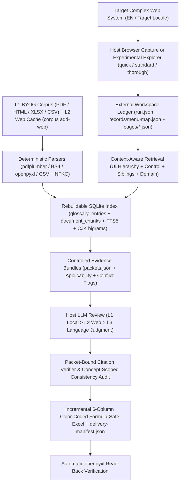

<div align="center">

# lingual-audit

### Domain-agnostic bilingual UI audit Agent Skill and local hybrid RAG CLI for complex web systems

[](LICENSE)
[](SKILL.md)
[](#works-with-any-ai-host)
[](pyproject.toml)
[](LICENSE)

<br>

Hundreds of web views carrying thousands of inconsistent labels, mistranslations, and exposed i18n keys?<br>
Handing reference PDFs straight to an LLM leads to missed short acronyms, fabricated citations, and cross-menu drift?<br>
Worried that probing form validation strings in a live app might trigger auto-save requests?<br>

<br>

**Bring-Your-Own-Glossary (BYOG) · Three-tier evidence · Incremental per-module export · 6-column color-coded Excel**

[中文](README.md) · [Comparison](#why-not-a-raw-llm) · [What it does](#what-it-does) · [How it works](#how-it-works) · [Excel format](#excel-output-format) · [Quick start](#quick-start) · [Contributing](CONTRIBUTING.md)

</div>

`lingual-audit` splits bilingual UI auditing into two clean layers: the host LLM handles language judgment, while deterministic Python tools handle corpus indexing, hybrid retrieval, packet-bound citation checks, and Excel export with automatic read-back verification.

## Why not a raw LLM

| Handing reference PDFs straight to an LLM | `lingual-audit` |
|---|---|
| Short 2 to 3 letter acronyms and short CJK labels are easy to miss | Exact acronym channel + SQLite FTS5 + CJK bigram local index |
| Models sometimes invent page numbers or cite unrelated entries | `review validate` binds every citation to that item's `packets.json` bundle |
| English-only definitions get used to justify Chinese UI labels | Applicability-first filtering blocks EN-only sources from authorizing target copy |
| Waiting until the whole app finishes risks losing hours of work | Writes and exports incrementally after every completed feature module |
| Spreadsheet formulas and raw observed copy are hard to audit | 6-column color-coded plain-text cells with automatic `openpyxl` read-back checks |

## What it does

- **Bring your own glossary (BYOG) + web evidence cache**: The workspace starts with an empty knowledge base slot (`corpus/raw/`, `corpus/manifest.json`, `corpus/authority_policy.json`). Drop in your own `PDF`, `HTML`, `XLSX`, or `CSV` glossaries for any industry without editing code. When the local glossary misses a term, the host agent can search the web and save the URL and verbatim excerpt with `lingual-audit corpus add-web` so web evidence flows through the same hash-checked index and citation verifier.
- **Three-tier evidence hierarchy (L1 > L2 > L3)**: Reviews combine **L1 local BYOG glossaries** (highest authority), **L2 cached web evidence** (`corpus add-web`, ranked by optional `web_domain_tiers`), and **L3 LLM language judgment** (fallback for obvious mistranslations, phrasing errors, and raw keys, labeled `[LLM 语义判断]` in the rationale column).
- **Incremental per-module delivery**: Finish one feature module, write its page inventory and review decisions to disk immediately, and re-export the Excel workbook so each completed module appends its sheet right away instead of waiting for hundreds of pages to finish.
- **Local SQLite FTS5 retrieval with packet-bound citation checks**: Parsers extract both verbatim and NFKC-normalized text from multi-format documents, build an exact short-acronym channel (`FX`, `IRS`, `BIC`) alongside a CJK bigram index, and filter sources by domain, region, and target locale before comparing normative precedence. `review validate` checks every citation against `packets.json` so missing or unrelated citations are rejected.
- **Experimental Playwright explorer with network isolation**: `lingual-audit explore` (experimental; requires `playwright>=1.48`) supports `quick`, `standard`, and `thorough` depths. It relies on semantic attributes (`[data-menu]`, `[data-i18n]`, `placeholder`) and marks pages with zero matched items as `blocked` rather than `fully_inspected`. For custom DOMs, record observations with your host browser tool or start from JSON inventory fixtures.
- **Color-coded, formula-safe Excel export**: Exports one worksheet per menu (`页面层级 | 系统英文 | 系统中文 | AI 建议中文 | 比对结论 | 修改理由与业务依据`), with 6 distinct verdict colors, a required business-focused rationale for every non-`保留` row, plain-text formula protection, and automatic `openpyxl` read-back checks.

## How it works



## Excel output format

| Column | Header | Purpose |
|---|---|---|
| A | `页面层级` | Full UI hierarchy (`Menu > Page State > Section > Control`) |
| B | `系统英文` | Verbatim observed English UI text (explicit text cell, formula-safe) |
| C | `系统中文` | Verbatim observed target-language UI text |
| D | `AI 建议中文` | Suggested translation (blank when `保留` or unverified) |
| E | `比对结论` | Color-coded verdict (`保留`, `建议修改`, `缺译`, `来源冲突`, `单语限制`, `待核对`) |
| F | `修改理由与业务依据` | Business-first rationale with brief provenance tag (required whenever verdict ≠ `保留`) |

`待核对` is reserved strictly for items whose bilingual UI text was not actually verified (such as unpaired controls, single-side observations, or blocked pages). Once bilingual text is verified, decide clearly between `保留` and `建议修改` (aside from `缺译`, `单语限制`, and `来源冲突`).

## Quick start

```bash
# 1. Create virtualenv & install (editable source install or standalone wheel)
python3 -m venv --system-site-packages .venv
.venv/bin/pip install -e ".[dev,browser]"

# 2. Check runtime capabilities
.venv/bin/lingual-audit doctor --json

# 3. Initialize an external BYOG workspace for any domain
.venv/bin/lingual-audit run init \
  --workspace /tmp/my-audit-ws \
  --run-id RUN-20261127-0001 \
  --app-label "My Web System" \
  --industry "general_web" \
  --depth standard

# 4. Drop your PDF/HTML/XLSX/CSV glossaries under /tmp/my-audit-ws/corpus/raw/
#    and optionally record web-searched excerpts with `corpus add-web`:
.venv/bin/lingual-audit corpus add-web \
  --manifest /tmp/my-audit-ws/corpus/manifest.json \
  --url "https://developer.mozilla.org/en-US/docs/Web/HTTP/Headers/Idempotency-Key" \
  --title "Idempotency-Key" \
  --en-term "Idempotency Key" \
  --zh-term "幂等键" \
  --excerpt "Idempotency Key ensures repeated requests have the same effect as a single request." \
  --policy /tmp/my-audit-ws/corpus/authority_policy.json

# 5. Ingest and index the corpus
.venv/bin/lingual-audit corpus ingest --manifest /tmp/my-audit-ws/corpus/manifest.json --output-dir /tmp/my-audit-ws/corpus/normalized
.venv/bin/lingual-audit corpus index --normalized-dir /tmp/my-audit-ws/corpus/normalized --db-path /tmp/my-audit-ws/corpus/index.sqlite

# 6. Run deterministic test suite
.venv/bin/pytest -v -p no:anyio
```

## Works with any AI host

This repository ships a self-contained Agent Skill ([SKILL.md](SKILL.md), [references/](references), [templates/](templates)) with zero vendored third-party skills:

- **Claude Code, Codex, Antigravity, WorkBuddy**: Load the repo directly or copy `SKILL.md`, `references/`, and `templates/` into your host's skills directory.
- **Any other LLM or agent framework**: Both the workflow and CLI are model-agnostic. Point any assistant at [SKILL.md](SKILL.md) and [references/](references), and run `lingual-audit` locally for deterministic indexing, citation checks, and Excel export.

## Design trade-offs

**Screen for applicability before ranking authority.**
In multi-region products, a `zh-HK` label and a `zh-CN` standard are often valid regional variants, and an English-only international standard explains what a concept means without authorizing a Chinese UI label. Checking `(domain, region, target_locale, language_scope)` before comparing `normative_precedence` avoids false overrides and keeps real source conflicts visible.

**Start with exact glossaries, SQLite FTS5, and CJK bigrams before adding dense vectors.**
UI strings are short: 2 to 3 letter acronyms or two-character Chinese terms. Embeddings drift on short labels, and SQLite's built-in `trigram` tokenizer cannot match queries shorter than three characters. A single-file SQLite index with exact channels and CJK bigrams runs offline with no external services or API keys, and produces repeatable test results. An RRF vector hook is included for teams that want to benchmark hybrid embeddings against a Golden Set.

**Isolate `thorough` input probes in a throwaway Playwright context.**
Skipping the Submit button does not prevent backend writes. Modern web forms routinely send `POST` or `PUT` auto-save requests on `input`, `change`, `blur`, or debounced timers. Blocking HTTP and WebSocket traffic (`playwright>=1.48`) for the entire lifetime of an isolated probe context and destroying that context afterward prevents any outbound write. Hosts without request interception skip synthetic input probes automatically.

**Separate the reviewer spreadsheet from the verification manifest.**
Reviewers want a clean sheet they can scan by color, with the UI path on the left and a clear business reason on the right. Engineering verification needs SHA-256 hashes and structured citation IDs. Putting human-readable decisions in the 6-column workbook and machine-checked provenance in `review.json` and `delivery-manifest.json` keeps both files clean.

## Contributing

Issues and pull requests are welcome, especially parser improvements, domain-agnostic golden-set fixtures, browser capture enhancements, and translations. See [CONTRIBUTING.md](CONTRIBUTING.md) for setup instructions, test commands, and sanitization rules.

## License

Released under the [MIT License](LICENSE).

Inspired by route-discovery conventions from `app-docs` and disk-backed session checkpointing from `planning-with-files`. Neither skill is vendored into this repository; all exploration, checkpointing, retrieval, and delivery code is implemented here under the MIT license.
